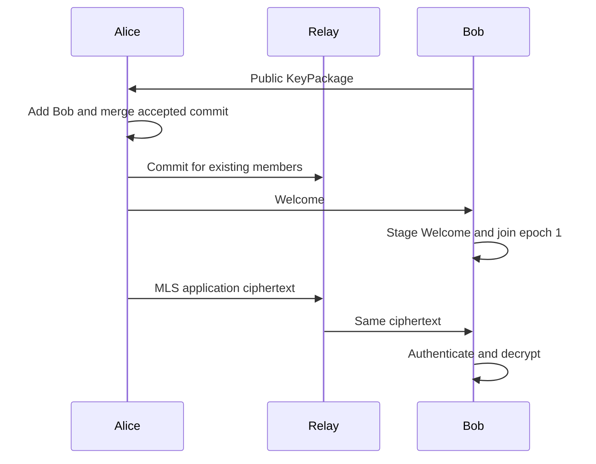

# What the experiment demonstrates

## Who owns what

Alice, Bob, and Charlie each own a separate `OpenMlsRustCrypto` provider, signing key, credential, and in-memory storage. Their group states refer to the same MLS group but are independently maintained. All three live in one process for simulation; this is not an isolation boundary against malicious code.

The chosen ciphersuite uses X25519, AES-128-GCM, SHA-256, and Ed25519. OpenMLS performs the cryptography and validates protocol messages. Dart supplies orchestration and displays results.

## Invitation and epochs

A KeyPackage contains public invitation material, including the recipient's credential and public init key. Its private counterpart remains in that recipient's provider. Alice validates the received KeyPackage, stages an Add, and merges the accepted commit. Existing members receive that commit. The new member receives a Welcome containing encrypted joining secrets; only the matching private material can open it. The ratchet-tree extension supplies the public tree in the Welcome path.

Every accepted membership or update commit creates a new epoch. Sending application messages does not itself advance the epoch. The demo immediately accepts local commits and then delivers them synchronously; a real delivery service needs ordering, conflict handling, and retry/recovery semantics before local pending state is merged.

## Key updates and post-compromise security

Bob's self-update creates fresh key material and changes the group secrets. Recovery requires that the attacker has lost access to Bob's device and cannot keep obtaining fresh secrets. A passive snapshot of Bob's earlier state is insufficient to follow Bob's own fresh update.

The UI shows synchronized epoch advancement and successful conversation afterward. The Rust `passive_snapshot_loses_access_after_compromised_member_self_update` test additionally copies Bob's in-memory state once, shows successful attacker decryption before the update, gives that copy the commit, and checks that new application decryption fails. The copy helper exists only under `cfg(test)`; there is no secret-export endpoint in the app.

This is a focused regression test of the wrapper's recovery path, not a proof of MLS security. It does not cover an active attacker impersonating users with stolen credentials, continued device compromise, identity re-verification, or operational recovery procedures. Updating some other member is not interchangeable with refreshing the compromised member's secrets.

## Removal

After Alice removes Bob, new group secrets are available to the remaining members. Bob may retain old plaintext and old state. In the UI he receives the removal commit and becomes inactive, but still receives future ciphertext and fails to decrypt it. The tests also withhold the removal commit from Bob and verify that his stale active state cannot read the new epoch. Thus exclusion does not depend on hiding packets or a UI permission flag.

## Authenticity and delivery limitations

BasicCredential labels do not establish verified human identities. The lab trusts all local members to make membership changes and automatically merges their valid commits. A product needs a credential/identity scheme and an authorization policy. Remove-by-label rejects absent or duplicate matches, but authenticated stable member identifiers would be a better product API.

The journal uses Base64 solely for displaying bytes; Base64 is not encryption. OpenMLS ciphertext is generated before this encoding. TLS-encoded MLS messages are distinct from the JSON used across the FFI boundary. The relay has no secrets, but the teaching UI intentionally displays plaintext and public metadata.

Out-of-order network handling, standalone proposal queues, concurrent commits, persistence, crash consistency, message history, storage encryption, denial-of-service limits, and key deletion guarantees remain outside this example.
